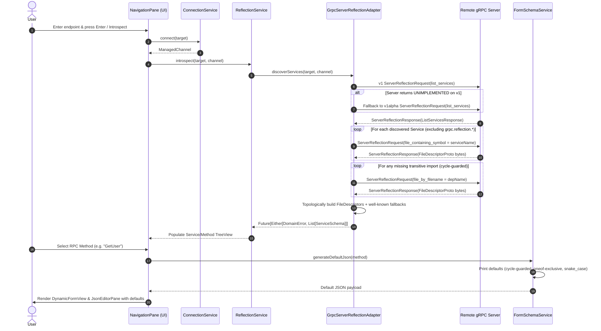
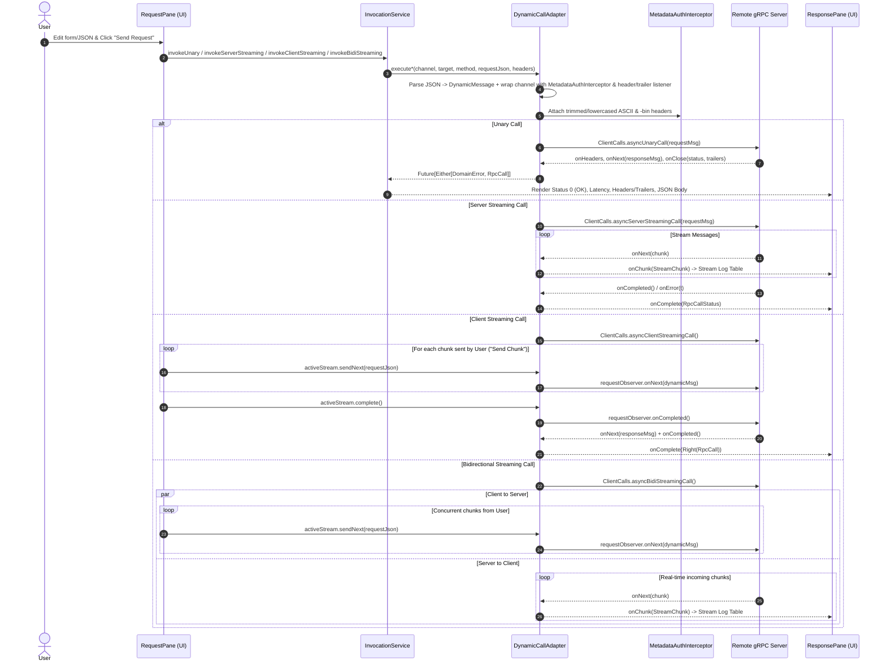
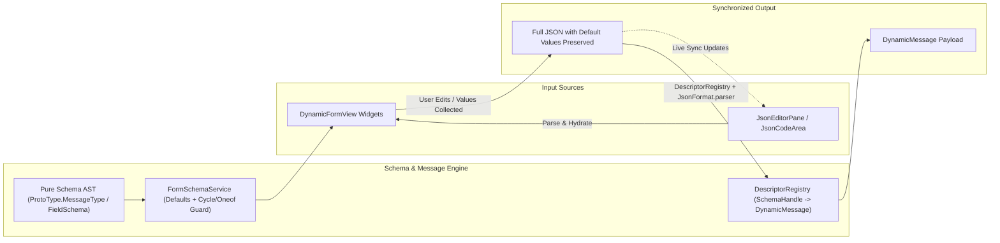
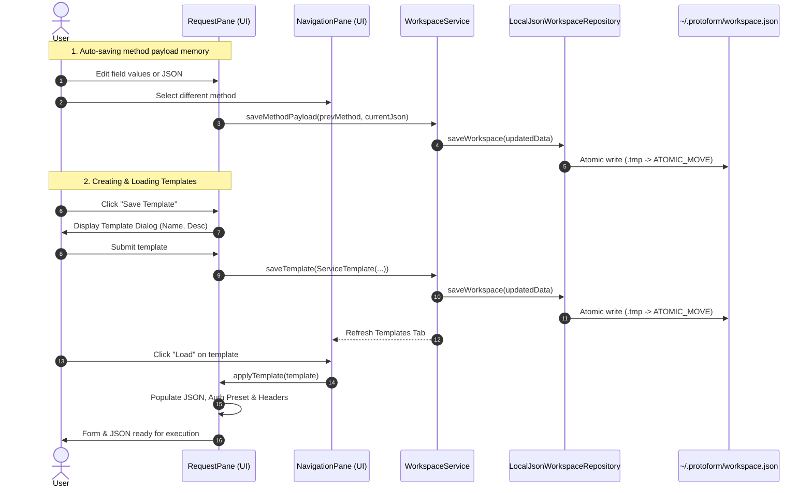

# ProtoForm — System Map & Architectural Diagrams

This document details the architectural boundaries, data flows, pipeline sequences, and internal subsystem communications for **ProtoForm**.

---

## 1. Domain-Driven Hexagonal Architecture (Ports & Adapters)

ProtoForm decouples JavaFX presentation, gRPC transport, server reflection, and local JSON storage into concentric layers around the domain core.

```mermaid
graph TD
    subgraph Inbound_Adapters [Presentation Tier / Inbound Adapters]
        UI_Main[ProtoFormApp JavaFX Window]
        UI_Title[CustomTitleBar & TargetBarControl]
        UI_Nav[ActivityRail & NavigationPane Drawer]
        UI_Req[RequestPane, SearchableSelector & StreamScriptPane]
        UI_Form[DynamicFormView, FormControls & WellKnownControls]
        UI_Json[JsonEditorPane & JsonCodeArea RichTextFX]
        UI_Auth[MetadataEditor View]
        UI_Resp[ResponsePane, StreamLog & ResponseDiffDialog]
        UI_State[AppState Reactive Properties]
        UI_Theme[ThemeManager & -pf-* Tokens]
    end

    subgraph Application_Layer [Application Layer / Use Cases]
        UC_Conn[ConnectionService]
        UC_Reflect[ReflectionService]
        UC_Schema[SchemaService]
        UC_Form[FormSchemaService]
        UC_Invoke[InvocationService]
        UC_Suite[SuiteRunnerService]
        UC_Workspace[WorkspaceService]
    end

    subgraph Domain_Core [Domain Layer - net.protoform.core]
        Agg_Target[EndpointTarget & TargetId/CallId]
        Agg_Call[RpcCall, RpcCallStatus, StreamChunk, JsonDiff, GrpcurlParser]

        subgraph Value_Objects [Pure Schema AST, Auth & Environments]
            VO_Service[ServiceSchema & SchemaHandle]
            VO_Method[MethodSchema & RpcPattern]
            VO_Field[FieldSchema & ProtoType]
            VO_Auth[AuthPreset, AuthProfile, MetadataHeader]
            VO_Env[EnvironmentConfig & VariableInterpolator]
        end

        Domain_Err[DomainError Hierarchy]
    end

    subgraph Ports [Outbound Ports / Traits - net.protoform.ports]
        Port_Chan[GrpcChannelPort]
        Port_Reflect[ServerReflectionPort]
        Port_Call[DynamicCallPort & ActiveClientStream]
        Port_Proto[SchemaParserPort & ProtoSourceParserPort]
        Port_Storage[WorkspacePort]
        Port_Auth[DynamicAuthTokenPort]
        Port_Kube[KubePortForwardPort]
    end

    subgraph Outbound_Adapters [Driven Adapters / Infrastructure]
        Adapter_Netty[NettyGrpcChannelAdapter]
        Adapter_Reflect[GrpcServerReflectionAdapter]
        Adapter_Call[DynamicCallAdapter]
        Adapter_Auth[MetadataAuthInterceptor & DynamicAuthResolver]
        Adapter_Kube[KubectlPortForwardAdapter]
        Adapter_Reg[DescriptorRegistry]
        Adapter_Proto[DescriptorSetSchemaAdapter & ProtocProtoSchemaAdapter]
        Adapter_JsonStore[LocalJsonWorkspaceRepository]
    end

    subgraph External_Systems [External Boundary]
        gRPC_Server[(Remote gRPC Server)]
        Local_FS[(Local Filesystem ~/.protoform)]
    end

    %% UI to Application
    UI_Title --> UC_Conn
    UI_Title --> UC_Reflect
    UI_Title --> UC_Schema
    UI_Req --> UC_Form
    UI_Req --> UC_Invoke
    UI_Req --> UC_Conn
    UI_Main --> UC_Workspace

    %% Application to Domain
    UC_Conn --> Agg_Target
    UC_Reflect --> VO_Service
    UC_Reflect --> VO_Method
    UC_Form --> VO_Field
    UC_Invoke --> Agg_Call
    UC_Workspace --> VO_Auth

    %% Application to Ports
    UC_Conn --> Port_Chan
    UC_Reflect --> Port_Reflect
    UC_Schema --> Port_Proto
    UC_Invoke --> Port_Call
    UC_Workspace --> Port_Storage

    %% Ports to Adapters
    Port_Chan --> Adapter_Netty
    Port_Reflect --> Adapter_Reflect
    Port_Call --> Adapter_Call
    Port_Proto --> Adapter_Proto
    Port_Storage --> Adapter_JsonStore

    %% Adapter composition & External
    Adapter_Call --> Adapter_Auth
    Adapter_Netty -->|HTTP/2 TLS or Plaintext| gRPC_Server
    Adapter_Reflect -->|grpc.reflection.v1 -> v1alpha fallback| gRPC_Server
    Adapter_Call -->|DynamicMessage RPC| gRPC_Server
    Adapter_JsonStore -->|Atomic JSON Persistence| Local_FS
```

---

## 2. Server Reflection & Service Discovery Sequence

When a user enters an endpoint (e.g. `localhost:50051` or `[::1]:50051`) and triggers introspection:

---

## 3. Dynamic RPC Call Execution Sequence (Unary & Streaming)

`DynamicCallAdapter` parses JSON into `DynamicMessage` (with transitive `TypeRegistry` for `google.protobuf.Any`), attaches `MetadataAuthInterceptor`, and captures response headers and trailers via a `ForwardingClientCallListener`:

---

## 4. Dynamic Form & JSON Bi-Directional Synchronization Pipeline

Whether an engineer edits visual widgets or raw JSON, default values and proto field names are preserved:

---

## 5. Service Template & Field Memory Lifecycle Sequence

ProtoForm persists per-method payload memory and reusable request templates atomically under `~/.protoform/workspace.json`:

